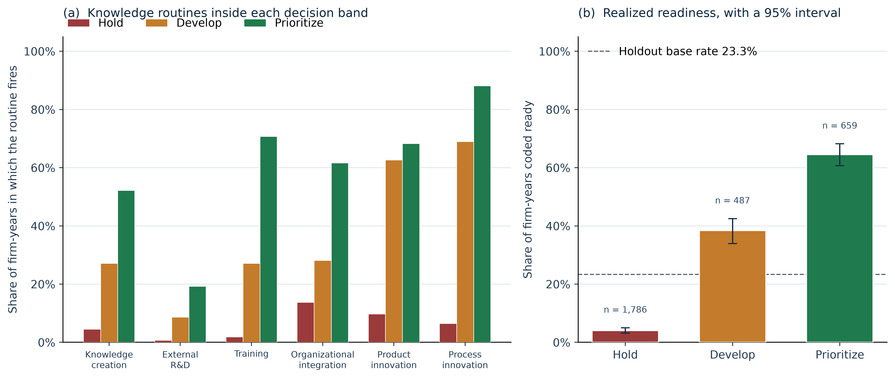
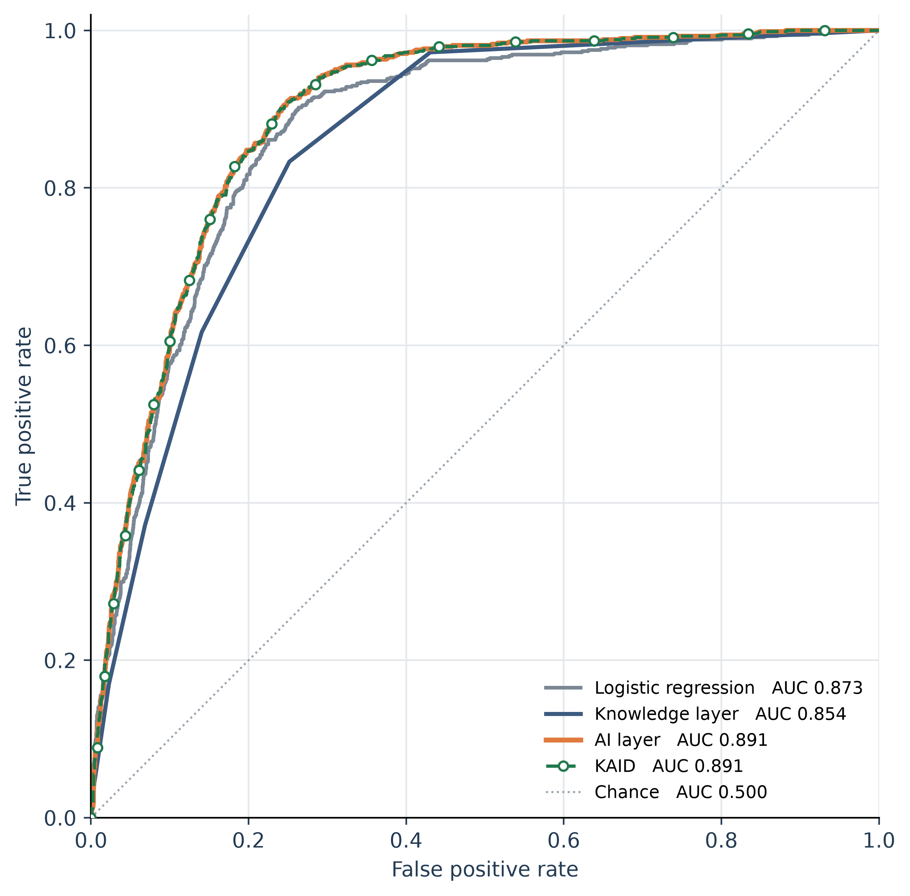

# A knowledge-based AI decision-support model for predicting digital transformation readiness from enterprise innovation data

Short Communication

Sai Vignesh Akkineni

Doctor of Business Administration candidate

## Highlights

- Readiness is scored from innovation routines, not from digital spend.
- Boosting holdout AUC is 0.891; the six-rule score is 0.854.
- Blending the two probabilities does not beat boosting.
- Hold, Develop, and Prioritize separate realized readiness.
- Each band names one missing routine for the next spend.

## Abstract

The purpose of this Short Communication is to test whether an enterprise innovation record can support a decision to hold, develop, or prioritize a digital offer. KAID scores six knowledge routines explicitly and uses gradient boosting to estimate the probability of digital-transformation readiness from the same innovation items. The readiness label is built only from digital markers — a website, an informatics and systems department, and software, hardware, and ICT innovation expenditure — and those markers are excluded from the predictors. On the public Latin American innovation surveys, 14,663 firm-years from 12,070 enterprises, a logistic regression reaches a holdout AUC of 0.873, the knowledge layer 0.854, and gradient boosting 0.891 (95% enterprise-bootstrap interval 0.879–0.903). Boosting exceeds the knowledge layer by 0.038 AUC and the logistic model by 0.018 AUC; both contrasts have bootstrap intervals that exclude zero (p < 0.001). Blending the knowledge probability into the boosting probability, with the training weight on boosting equal to 0.95, does not improve on boosting (difference −0.0002; 95% interval −0.0006 to 0.0001; p = 0.223). The decision bands do separate firms. On the holdout, 4.0% of Hold firm-years are ready (95% interval 3.1–5.0), 38.4% of Develop firm-years (33.9–42.5), and 64.5% of Prioritize firm-years (60.7–68.2). Hold is missing process innovation. Develop is missing innovation training. Prioritize still often lacks an R&D routine.

Keywords: knowledge-based systems; artificial intelligence; enterprise innovation data; digital transformation; decision support; data-centric business models; entrepreneurship

## 1. Introduction

Digital transformation is a change in how a firm creates value, not a purchase of software (Gong & Ribiere, 2021; Verhoef et al., 2021; Vial, 2019). Data-centric business models depend on an offer a customer will pay for (Hartmann et al., 2016). Digital entrepreneurship is the decision to pursue that offer (Nambisan, 2017). Analytics-capability studies find the association with performance running through dynamic, operational, or entrepreneurial capabilities, and through the management of the analytics capability itself (Ciampi et al., 2021; Fosso Wamba et al., 2017; Mikalef et al., 2020; Song et al., 2024; Wu et al., 2024). Platform studies of cross-border e-commerce likewise place data elements inside the link from transformation to enterprise performance (Yang et al., 2023). Among born-digital small and medium-sized enterprises, performance has been associated with dynamic capabilities and collaborative innovation rather than with possession of the technology alone (Pundziene & Geryba, 2024).

The knowledge-based view treats the firm as an institution that integrates specialist knowledge into a routine that can be used (Grant, 1996; Kogut & Zander, 1992). An artificial-intelligence output is another specialist product. Reviews of artificial intelligence in innovation management treat the model as an input to the innovation process (Haefner et al., 2021; Mariani et al., 2023), and the conversion of an AI capability into a business model is described as a co-evolutionary process (Sjödin et al., 2021). The output changes what the firm sells only when the surrounding routines can carry it (Foss & Saebi, 2017; Teece, 2010). Case and review work describes digital transformation itself as a continuing renewal of dynamic capabilities (Schneider et al., 2024; Warner & Wäger, 2019; Wohlleber et al., 2024). Readiness for that renewal is discussed as a multidimensional state, covering technological resources, business processes, management capability, human capability, and culture, and it is not settled by a single technology indicator (Michelotto & Joia, 2024). The same literature links transformation to the balance of exploitative and exploratory innovation (Liang & Li, 2024) and frames it as a springboard for product, process, and business-model innovation, including servitization of a product firm (Bresciani et al., 2021; Frank et al., 2019; Paiola & Gebauer, 2020). Field maps of that joint literature are already large (Gao et al., 2022; Kraus et al., 2022). A multidisciplinary agenda for artificial intelligence asks for organizational consequences, not only for a higher score (Dwivedi et al., 2021), and adoption studies in manufacturing locate take-up in technological, organizational, and environmental conditions (Chatterjee et al., 2021).

The stake is the next budget. A firm can add a website, a systems department, or a software line and still have no routine that carries a new offer. Counting those markers again as predictors would only rediscover the purchase. The studies cited above map the transformation, the capability path, or the readiness construct. None of them reports the comparison a budget decision needs: a holdout in which the digital markers are the label only, a transparent rule score is set against logistic regression and gradient boosting on enterprises that do not cross the split, and each probability band names the innovation routine that separates it. That comparison is the opening this Short Communication fills. Section 2 defines the label, the rules, and the scores. Section 3 asks which score carries the probability. Section 4 asks what a manager should do once that ranking is known. Whether the rule score, the boosting score, or a blend of the two is better is left to the holdout.

This paper proposes KAID, a knowledge-based AI decision-support model for that comparison. Unlike a classifier that stops at a probability, KAID keeps the routines visible and ties each decision band to the routine that separates it from firms judged ready to proceed. The contribution is threefold, and each part is bounded by the test. First, a readiness label is constructed only from digital markers, so the innovation predictors are not scored against themselves. Second, an explicit six-rule knowledge layer is coupled to gradient boosting, with the coupling weight chosen on training data and then frozen. Third, an enterprise-level holdout reports a linear baseline, bootstrap intervals, and paired contrasts, so a claim that one layer adds something can be checked. The originality is that separation of roles. Section 3 asks which score carries the probability. Section 4 asks what the rules add once that question is answered. Averaging the two scores is not treated as a third contribution unless the holdout shows a gain.

## 2. Methodology

The design follows the gap in Section 1. The label is built only from digital markers, so the innovation record is not scored against itself. The knowledge layer stays a short list of routines a manager can read. The weight that blends that list with the boosting probability is chosen on training enterprises and then frozen, so the holdout can reject the blend.

### 2.1 Readiness label

Let firm-year i have a set M_i of digital markers that the survey actually asked. The five markers are a website, a formal informatics and systems department, software innovation expenditure, hardware innovation expenditure, and ICT innovation expenditure. Each observed marker d_im equals 1 when the firm reports it and 0 otherwise. The label is given by Eq. (1):

$$
y_i = 1\left\{|M_i| \ge 3 \;\text{and}\; \frac{1}{|M_i|}\sum_{m \in M_i} d_{im} \ge 0.5\right\}. \quad (1)
$$

Firm-years with fewer than three observed markers are excluded, because the label is not identified. The markers in M_i are not used as predictors. A model that predicted digital spend from digital spend would not be a test of the innovation record.

### 2.2 Knowledge-rule layer

The knowledge layer is a production-rule base R = {r1, …, r6}, evaluated once per firm-year. A rule fires when any of its observed survey items equals 1. If every item for that rule is missing, the rule is missing and is left out of the share. The six rules, in the order used by the code, are knowledge creation (in-house R&D expenditure or a formal R&D department), external knowledge (external R&D expenditure), training for innovation, organizational integration (organizational innovation), product innovation, and process innovation. Innovation items follow the Oslo Manual (OECD/Eurostat, 2018).

Let f_{ir} equal 1 when rule r fires for firm-year i and 0 when the rule is observed and does not fire. Let R_i be the set of rules with at least one observed item. In this estimation sample every retained firm-year has all six rules observed, so |R_i| = 6 throughout. The raw knowledge score is the share of those rules that fire, given by Eq. (2),

$$
S_i^{0} = \frac{1}{|R_i|}\sum_{r \in R_i} f_{ir}, \quad (2)
$$

and a training-only isotonic map g(·) converts that share into a probability S_i = g(S_i^0). The map is an isotonic regression of the readiness label on S^0, clipped to the unit interval. It is fit on training enterprises and applied unchanged to the holdout. External R&D fires for only 6.0% of the estimation sample, so it is retained as a rule and is not used as the routine a band most often lacks: a rare rule is absent in every band and would dominate that comparison for a mechanical reason.

Two candidate rules were specified and then removed from the main model. Innovation cooperation was not asked of 39% of estimation-sample firms, and the internet as an information source was not asked of 51%. Among firms who were not asked about cooperation, 0.1% were coded ready. Among firms who were not asked about the internet, 2.8% were coded ready. Using those gaps would have scored the questionnaire. Section 3 reports what cooperation adds on the subset where the question was fielded.

### 2.3 AI layer and the decision score

The AI layer is a histogram gradient booster in the gradient-boosting family (Friedman, 2001). Its inputs are the survey items inside the six rules, plus marketing innovation, foreign ownership, group membership, log(1 + employment), country, year, and sector. The fitted model uses trees of depth 4, a learning rate of 0.06, at most 400 iterations, an L2 penalty of 1.0, and at least 40 observations in a leaf. Early stopping holds out 15% of the rows inside the sample being fitted and stops after 20 rounds without improvement. That internal split is not the enterprise holdout, and it does not choose w. Missing numeric answers stay missing, so a tree may split on missingness for items that were asked of nearly every firm. Country, year, and sector are one-hot encoded from the rows of the current fit only. No class weight is applied. The probabilities are left on the scale of the outcome.

Let P_i be the boosting probability. The KAID score is given by Eq. (3),

$$
K_i = w P_i + (1 - w) S_i, \quad (3)
$$

where w is chosen on out-of-fold predictions inside the training sample to minimize the Brier score, then frozen. The search is the grid {0, 0.05, …, 1}. The holdout is not used to pick w, and the band in Eq. (4) is a function of K_i, not of P_i alone. Firms are not classified by maximizing F1. They are placed with two cuts fixed before the holdout is opened. Let π be the training readiness rate. The band is given by Eq. (4):

$$
\text{band}(K_i) =
\begin{cases}
\text{Hold} & \text{if } K_i < \pi, \\
\text{Develop} & \text{if } \pi \le K_i < 0.50, \\
\text{Prioritize} & \text{if } K_i \ge 0.50.
\end{cases} \quad (4)
$$

Hold means the score is below the rate at which firms in the training sample are ready. Prioritize means the model assigns a probability of at least one half in a sample where about one firm in four is ready. Develop is the interval between those cuts. For Hold and Develop, the reported routine is the common routine whose absence most exceeds its absence among Prioritize firms. For Prioritize, it is the common routine most often still absent. A routine is common when it fires for at least 15% of the estimation sample.

Algorithm 1. KAID Decision

Input: enterprise innovation record; digital markers held out of the record; training enterprises.
Output: band and the routine the band points to.

1: Drop any firm-year with fewer than three observed digital markers, and set y_i by Eq. (1).
2: Split enterprises, not firm-years, into training and holdout. No enterprise enters both.
3: On five enterprise-grouped folds of the training sample, fit g and the boosting model. Choose w in Eq. (3) on those out-of-fold scores.
4: Refit g and the boosting model on all training enterprises. Freeze w. The holdout is not used in steps 3 or 4.
5: Score each holdout firm-year with Eq. (3) and assign the band in Eq. (4).
6: Name the routine that separates that band from Prioritize, using only routines that fire for at least 15% of firms.
7: Return the band, the score, and the named routine.

The holdout split, the boosting fit, the logistic fit, and the AUC bootstrap use seed 42. The band-rate bootstrap uses seed 43. The five training folds are deterministic given the enterprises. Running the accompanying code rebuilds every number in Section 3.

### 2.4 Data, sample, and evaluation

The source is the public Harmonized Latin American Innovation Surveys database, LAIS (Crespi et al., 2022). The estimation rule in Eq. (1) keeps 14,663 firm-years and 12,070 enterprises in Ecuador, El Salvador, Panama, Paraguay, and Peru, in 2009, 2012, 2013, 2014, 2015, and 2016. The ready share is 23.6%. Software, hardware, and ICT expenditure were asked of every retained firm-year. The informatics department was asked of 90.6%, and a website of 25.8%, so the label is a digital-spend and digital-organization bundle, with the website used where the survey asked it. Software and hardware expenditure sit close to the ICT item in these questionnaires; the label is that bundle, not five independent technologies.

Among retained firms the six routines fire at the following rates: knowledge creation 19.9%, external R&D 6.0%, training 21.3%, organizational innovation 27.9%, product innovation 32.0%, and process innovation 34.9%. A website, where asked, is reported by 50.5% of firms. An informatics department, where asked, is reported by 33.0%. Software, hardware, and ICT expenditure are reported by 18.5%, 16.7%, and 24.1%.

The holdout is a group split of 20% of enterprises, seed 42. An enterprise is the country code joined to the firm identifier, so a firm that appears in two survey years stays on one side of the split. The code stops if any enterprise is in both samples. The training sample has 11,731 firm-years (9,656 enterprises). The holdout has 2,932 firm-years (2,414 enterprises) and a ready rate of 23.3%. Four scores are compared on that holdout: logistic regression, the knowledge layer, gradient boosting, and KAID. The logistic baseline median-imputes numeric inputs, standardizes them, and fits an L2-penalized logistic regression with C = 1. That imputation is not used in the boosting layer. The same five enterprise-grouped training folds that choose w also supply the out-of-fold scores for the logistic baseline.

Classification thresholds used only for F1, precision, and recall are chosen on those out-of-fold scores. The grid runs from 0.05 to 0.95 in steps of 0.025, and the cut with the highest training F1 is frozen. AUC and the Brier score do not use those thresholds. The decision bands do not use them either.

Uncertainty is an enterprise bootstrap with 2,000 replicates. Each replicate draws holdout enterprises with replacement and keeps every firm-year of a drawn enterprise. AUC intervals and paired AUC differences use seed 42. Band-rate intervals use seed 43. A replicate that draws a single class is dropped. A two-sided bootstrap p-value is twice the smaller of the share of replicates in which the paired difference is at most zero and the share in which it is at least zero, and it is capped at 1. When no replicate changes sign, the reported result is p < 0.001. Section 3 opens with the probability comparison. The bands are read only after that comparison is on the table.

## 3. Results

The holdout is used here for the first time. Table 1 compares the four scores on discrimination, calibration, and a frozen F1 cut. Table 2 tests the paired differences. Figure 1 then shows what those scores do as a budget screen, and Figure 2 shows why the blended curve does not separate from boosting.

Table 1 is the holdout comparison. Logistic regression reaches AUC 0.873 (95% interval 0.860–0.887). The six-rule knowledge layer reaches 0.854 (0.840–0.867). Gradient boosting reaches 0.891 (0.879–0.903). KAID reaches 0.891 (0.878–0.903). The Brier score moves in the same direction: 0.120, 0.125, 0.110, and 0.110. Mean predicted probability on the holdout is 0.237 for boosting and 0.237 for KAID, against a ready rate of 0.233, so the probabilities sit on the scale of the outcome. The Prioritize cut of 0.50 is therefore a high bar relative to the base rate, not a cut that merely recovers the sample prevalence.

Table 1. Holdout comparison of readiness scores.

| Method | AUC | 95% interval | F1 | Precision | Recall | Brier |
|---|---:|---:|---:|---:|---:|---:|
| Logistic regression | 0.873 | 0.860–0.887 | 0.660 | 0.539 | 0.851 | 0.120 |
| Knowledge layer | 0.854 | 0.840–0.867 | 0.626 | 0.502 | 0.833 | 0.125 |
| AI layer | 0.891 | 0.879–0.903 | 0.678 | 0.565 | 0.848 | 0.110 |
| KAID | 0.891 | 0.878–0.903 | 0.678 | 0.584 | 0.808 | 0.110 |

Lower Brier is better. The 95% intervals are enterprise bootstraps.

Table 2 states the paired contrasts. Boosting exceeds the knowledge layer by 0.038 AUC (0.029 to 0.046). It exceeds logistic regression by 0.018 (0.012 to 0.025). Both intervals exclude zero, and no bootstrap replicate reverses the sign (p < 0.001). The knowledge layer does not beat the linear model. Logistic regression exceeds it by 0.020 AUC (0.011 to 0.028; p < 0.001). The training step sets the KAID weight at w = 0.95. The blended score is 0.0002 AUC below boosting. The interval runs from −0.0006 to 0.0001 and includes zero (p = 0.223). KAID does not predict better than the AI layer.

Table 2. Paired enterprise-bootstrap contrasts on holdout AUC.

| Contrast | Difference in AUC | 95% interval | p |
|---|---:|---:|---:|
| AI − knowledge | +0.038 | 0.029 to 0.046 | < 0.001 |
| AI − logistic | +0.018 | 0.012 to 0.025 | < 0.001 |
| Knowledge − logistic | −0.020 | −0.028 to −0.011 | < 0.001 |
| KAID − AI | −0.0002 | −0.0006 to 0.0001 | 0.223 |

Two thousand replicates. A negative difference means the first method is worse.

Figure 1. Holdout decision bands from the KAID score K. Panel (a) is the share of firm-years in which each knowledge routine fires. All six routines were observed for every retained firm-year. Panel (b) is the share coded ready, with a 95% enterprise-bootstrap interval. The dashed line is the holdout base rate, 23.3%. The three intervals do not overlap. Process innovation and training are the routines that separate Hold from Prioritize.

Figure 1 is the decision the probability is for. Of 2,932 holdout firm-years, 1,786 fall in Hold and 4.0% of them are ready (3.1–5.0). 487 fall in Develop and 38.4% are ready (33.9–42.5). 659 fall in Prioritize and 64.5% are ready (60.7–68.2). The intervals do not overlap. Relative to Prioritize firms, Hold firms are separated by process innovation: it is absent for 93.5% of Hold firm-years and for 11.8% of Prioritize firm-years. Training is absent for 98.2% of Hold firm-years. Develop firms are separated by training, absent for 72.9% against 29.3% in Prioritize. Inside Prioritize, the routine most often still missing is knowledge creation: 48.0% have neither in-house R&D expenditure nor an R&D department. External R&D is rare in every band and is not used as that recommendation.

Figure 2. Holdout receiver-operating curves. The dashed KAID curve is marked so it remains visible where it lies on the AI curve. The training weight on the AI layer is 0.95, and the paired difference in AUC is −0.0002 (p = 0.223). The diagonal is chance.

Figure 2 shows the same paired result as overlapping curves. Process innovation is the strongest single boosting input. Dropping it and refitting the AI layer leaves a holdout AUC of 0.852, close to the knowledge layer and still above chance. The gain from 0.852 to 0.891 is the rest of the innovation record, not one item standing alone. On the 1,782 holdout firm-years where cooperation was asked, the main AI model has AUC 0.800, cooperation alone has AUC 0.634, and adding the cooperation item moves AUC from 0.800 to 0.811.

## 4. Discussion

Section 3 ranked the scores. The reason to keep the rules is not that ranking. A manager who receives only an AUC still does not know which routine the next budget would have to supply, which is the decision the introduction set out to support.

The holdout separates two questions that the cited literature often keeps together. The first is which score carries the probability. A linear reading of the innovation survey already reaches AUC 0.873. Six explicit routines are a readable compression of that record, and they lose to the linear model by 0.020 AUC. Boosting adds a further 0.018 over logistic regression. Blending the knowledge probability back in, at the training weight w = 0.95, does not improve on boosting (p = 0.223). That negative result qualifies the second contribution. Coupling the layers was worth testing because reviews treat an artificial-intelligence output as an input to the innovation process rather than as a substitute for it (Haefner et al., 2021; Mariani et al., 2023; Sjödin et al., 2021). The organizational consequence those reviews ask for is not, on this holdout, a higher score (Dwivedi et al., 2021). A reader who wants only a probability can stop at the AI layer.

The second question is what the rules add once the probability is known. Capability studies locate performance in dynamic, operational, entrepreneurial, or analytics-management capabilities rather than in the data stock alone (Ciampi et al., 2021; Fosso Wamba et al., 2017; Mikalef et al., 2020; Song et al., 2024; Wu et al., 2024). This paper does not estimate those mediators. What it can show is the routine the band is missing. In Figure 1, panel (a), Hold is separated from Prioritize by process innovation, Develop by training, and Prioritize still lacks knowledge creation in 48.0% of firm-years. Those three objects sit next to the product, process, and business-model innovation that the digital-transformation literature treats as the content of the change (Bresciani et al., 2021; Frank et al., 2019; Liang & Li, 2024; Paiola & Gebauer, 2020). The holdout does not show that installing the named routine causes readiness. It shows which common routine is absent where the score is low, and which one is still absent where the score is high. About half of Prioritize firm-years still need a place where knowledge is created and kept (Grant, 1996).

The cooperation check belongs with that distinction. Where the question was fielded, cooperation moves AUC from 0.800 to 0.811. Research on enterprise innovation capability treats cooperative culture as one condition accompanying digital transformation (Liu et al., 2025). That literature does not justify imputing a cooperation answer where the question was omitted, because firms who were not asked were almost never coded ready. The same limit applies to the internet-as-source item removed in Section 2.2.

### 4.1 Limitations

The label is a survey proxy. It is not revenue from a data product, and it is not a completed transformation. Organizational digital-transformation readiness, as reviewed in the literature, also includes management capability, human capability, and culture (Michelotto & Joia, 2024). Those dimensions are not in the five markers. The five countries and the years 2009–2016 are the waves in which enough digital markers were asked. A website was on the questionnaire for a quarter of the estimation sample. Process innovation can include support activities under the Oslo Manual (OECD/Eurostat, 2018), so part of its contribution sits near the label even though the spend items themselves are not predictors. The design is cross-sectional. Training can follow a digital project as well as precede it. The bootstrap respects enterprises, not a survey-weighted population, and it does not refit the boosting model inside each replicate; the intervals describe the holdout scores, not the sampling variability of a refitted model. The comparison is with the studies cited here. It is not a census of every readiness model.

The microdata are not included. LAIS is distributed by the Inter-American Development Bank under CC BY-NC-ND 3.0 IGO. The script downloads the public file, rebuilds both figures, and writes the metrics.

## 5. Conclusion

This Short Communication presented KAID, a knowledge-based AI decision aid that predicts digital-transformation readiness from enterprise innovation data and returns a band rather than only a rank. The studies cited in the introduction map digital transformation, capabilities, and readiness. They do not score this innovation record. Across 2,932 holdout firm-years, gradient boosting was the better probability, a logistic model beat an explicit six-rule score, and blending the two probabilities did not help. The bands still separated realized readiness from 4.0% to 64.5%, and each band pointed to a different missing routine: process innovation, training, or knowledge creation.

KAID is a pre-commitment screen for a data-centric offer. It matters where a firm must decide the next budget before it has revenue from a digital product. It is not a valuation of that offer, and it is not evidence that buying the named routine will cause readiness. Used that way, the negative result on the blend is part of the finding. The probability and the rule answer different questions, and only one of them should be averaged.

## CRediT authorship contribution statement

Sai Vignesh Akkineni: Conceptualization, Methodology, Software, Validation, Formal analysis, Investigation, Data curation, Writing - original draft, Writing - review and editing, Visualization.

## Declaration of competing interest

The author declares that there are no known competing financial interests or personal relationships that could have appeared to influence the work reported in this manuscript.

## Declaration of generative AI and AI-assisted technologies

During preparation of this manuscript, AI-assisted tools were used for language drafting, editing, organization, and manuscript formatting support. The author reviewed and edited the content and takes full responsibility for the final manuscript. The tables and figures were generated from the executable analysis and from `results.json`.

## Funding

This research received no specific grant from any funding agency in the public, commercial, or not-for-profit sectors.

## Data availability

The firm microdata are the public LAIS file (Crespi et al., 2022), https://doi.org/10.60966/hbz4-cm10. No new data were collected from human participants, and no identifiable firm record is reported. The microdata are not redistributed. Running `kaid.py` downloads that file, refits every model under seed 42, and regenerates `figures/figure1_decision.png`, `figures/figure2_roc.png`, and `results.json`.

## References

Bresciani, S., Huarng, K.-H., Malhotra, A., & Ferraris, A. (2021). Digital transformation as a springboard for product, process and business model innovation. *Journal of Business Research, 128*, 204–210. https://doi.org/10.1016/j.jbusres.2021.02.003

Chatterjee, S., Rana, N. P., Dwivedi, Y. K., & Baabdullah, A. M. (2021). Understanding AI adoption in manufacturing and production firms using an integrated TAM-TOE model. *Technological Forecasting and Social Change, 170*, Article 120880. https://doi.org/10.1016/j.techfore.2021.120880

Ciampi, F., Demi, S., Magrini, A., Marzi, G., & Papa, A. (2021). Exploring the impact of big data analytics capabilities on business model innovation: The mediating role of entrepreneurial orientation. *Journal of Business Research, 123*, 1–13. https://doi.org/10.1016/j.jbusres.2020.09.023

Crespi, G., Guillard, C., Salazar, M., & Vargas, F. (2022). *Harmonized Latin American Innovation Surveys database (LAIS): Firm-level microdata for the study of innovation, 2007–2017* [Data set]. Inter-American Development Bank. https://doi.org/10.60966/hbz4-cm10

Dwivedi, Y. K., Hughes, L., Ismagilova, E., Aarts, G., Coombs, C., Crick, T., Duan, Y., Dwivedi, R., Edwards, J., Eirug, A., Galanos, V., Ilavarasan, P. V., Janssen, M., Jones, P., Kar, A. K., Kizgin, H., Kronemann, B., Lal, B., Lucini, B., ... Williams, M. D. (2021). Artificial intelligence (AI): Multidisciplinary perspectives on emerging challenges, opportunities, and agenda for research, practice and policy. *International Journal of Information Management, 57*, Article 101994. https://doi.org/10.1016/j.ijinfomgt.2019.08.002

Foss, N. J., & Saebi, T. (2017). Fifteen years of research on business model innovation: How far have we come, and where should we go? *Journal of Management, 43*(1), 200–227. https://doi.org/10.1177/0149206316675927

Fosso Wamba, S., Gunasekaran, A., Akter, S., Ren, S. J., Dubey, R., & Childe, S. J. (2017). Big data analytics and firm performance: Effects of dynamic capabilities. *Journal of Business Research, 70*, 356–365. https://doi.org/10.1016/j.jbusres.2016.08.009

Frank, A. G., Mendes, G. H. S., Ayala, N. F., & Ghezzi, A. (2019). Servitization and Industry 4.0 convergence in the digital transformation of product firms: A business model innovation perspective. *Technological Forecasting and Social Change, 141*, 341–351. https://doi.org/10.1016/j.techfore.2019.01.014

Friedman, J. H. (2001). Greedy function approximation: A gradient boosting machine. *The Annals of Statistics, 29*(5), 1189–1232. https://doi.org/10.1214/aos/1013203451

Gao, P., Wu, W., & Yang, Y. (2022). Discovering themes and trends in digital transformation and innovation research. *Journal of Theoretical and Applied Electronic Commerce Research, 17*(3), 1162–1184. https://doi.org/10.3390/jtaer17030059

Gong, C., & Ribiere, V. (2021). Developing a unified definition of digital transformation. *Technovation, 102*, Article 102217. https://doi.org/10.1016/j.technovation.2020.102217

Grant, R. M. (1996). Toward a knowledge-based theory of the firm. *Strategic Management Journal, 17*(S2), 109–122. https://doi.org/10.1002/smj.4250171110

Haefner, N., Wincent, J., Parida, V., & Gassmann, O. (2021). Artificial intelligence and innovation management: A review, framework, and research agenda. *Technological Forecasting and Social Change, 162*, Article 120392. https://doi.org/10.1016/j.techfore.2020.120392

Hartmann, P. M., Zaki, M., Feldmann, N., & Neely, A. (2016). Capturing value from big data – a taxonomy of data-driven business models used by start-up firms. *International Journal of Operations & Production Management, 36*(10), 1382–1406. https://doi.org/10.1108/IJOPM-02-2014-0098

Kogut, B., & Zander, U. (1992). Knowledge of the firm, combinative capabilities, and the replication of technology. *Organization Science, 3*(3), 383–397. https://doi.org/10.1287/orsc.3.3.383

Kraus, S., Durst, S., Ferreira, J. J., Veiga, P., Kailer, N., & Weinmann, A. (2022). Digital transformation in business and management research: An overview of the current status quo. *International Journal of Information Management, 63*, Article 102466. https://doi.org/10.1016/j.ijinfomgt.2021.102466

Liang, R., & Li, Y. (2024). How digital transformation affects exploitative and exploratory innovation: An innovation structure perspective. *IEEE Transactions on Engineering Management, 71*, 10912–10923. https://doi.org/10.1109/TEM.2024.3408322

Liu, T., Leng, J., Zhu, S., & Fu, R. (2025). Digital transformation and enterprise innovation capability: From the perspectives of enterprise cooperative culture and innovative culture. *Journal of Theoretical and Applied Electronic Commerce Research, 20*(2), Article 136. https://doi.org/10.3390/jtaer20020136

Mariani, M. M., Machado, I., Magrelli, V., & Dwivedi, Y. K. (2023). Artificial intelligence in innovation research: A systematic review, conceptual framework, and future research directions. *Technovation, 122*, Article 102623. https://doi.org/10.1016/j.technovation.2022.102623

Michelotto, F., & Joia, L. A. (2024). Organizational digital transformation readiness: An exploratory investigation. *Journal of Theoretical and Applied Electronic Commerce Research, 19*(4), 3283–3304. https://doi.org/10.3390/jtaer19040159

Mikalef, P., Krogstie, J., Pappas, I. O., & Pavlou, P. A. (2020). Exploring the relationship between big data analytics capability and competitive performance: The mediating roles of dynamic and operational capabilities. *Information & Management, 57*(2), Article 103169. https://doi.org/10.1016/j.im.2019.05.004

Nambisan, S. (2017). Digital entrepreneurship: Toward a digital technology perspective of entrepreneurship. *Entrepreneurship Theory and Practice, 41*(6), 1029–1055. https://doi.org/10.1111/etap.12254

OECD/Eurostat. (2018). *Oslo Manual 2018: Guidelines for collecting, reporting and using data on innovation* (4th ed.). OECD Publishing. https://doi.org/10.1787/9789264304604-en

Paiola, M., & Gebauer, H. (2020). Internet of things technologies, digital servitization and business model innovation in BtoB manufacturing firms. *Industrial Marketing Management, 89*, 245–264. https://doi.org/10.1016/j.indmarman.2020.03.009

Pundziene, A., & Geryba, L. (2024). Managing technological innovation: Dynamic capabilities, collaborative innovation, and born-digital SMEs' performance. *IEEE Transactions on Engineering Management, 71*, 6968–6981. https://doi.org/10.1109/TEM.2023.3281722

Schneider, M. H. G., Kanbach, D. K., Kraus, S., & Dabić, M. (2024). Transform me if you can: Leveraging dynamic capabilities to manage digital transformation. *IEEE Transactions on Engineering Management, 71*, 9094–9108. https://doi.org/10.1109/TEM.2023.3319406

Sjödin, D., Parida, V., Palmié, M., & Wincent, J. (2021). How AI capabilities enable business model innovation: Scaling AI through co-evolutionary processes and feedback loops. *Journal of Business Research, 134*, 574–587. https://doi.org/10.1016/j.jbusres.2021.05.009

Song, J., Xiang, Y., Huang, B., Xie, Y., & Li, Y. (2024). Exploring how big data analytics management capability fuel market performance: Evidence from a mediated moderation model. *IEEE Transactions on Engineering Management, 71*, 9080–9093. https://doi.org/10.1109/TEM.2023.3312774

Teece, D. J. (2010). Business models, business strategy and innovation. *Long Range Planning, 43*(2–3), 172–194. https://doi.org/10.1016/j.lrp.2009.07.003

Verhoef, P. C., Broekhuizen, T., Bart, Y., Bhattacharya, A., Dong, J. Q., Fabian, N., & Haenlein, M. (2021). Digital transformation: A multidisciplinary reflection and research agenda. *Journal of Business Research, 122*, 889–901. https://doi.org/10.1016/j.jbusres.2019.09.022

Vial, G. (2019). Understanding digital transformation: A review and a research agenda. *The Journal of Strategic Information Systems, 28*(2), 118–144. https://doi.org/10.1016/j.jsis.2019.01.003

Warner, K. S. R., & Wäger, M. (2019). Building dynamic capabilities for digital transformation: An ongoing process of strategic renewal. *Long Range Planning, 52*(3), 326–349. https://doi.org/10.1016/j.lrp.2018.12.001

Wohlleber, A. J., Bock, M., Birkel, H., & Hartmann, E. (2024). Implementing vital dynamic capabilities to succeed in digital transformation: A multiple-case study in maritime container shipping. *IEEE Transactions on Engineering Management, 71*, 13627–13645. https://doi.org/10.1109/TEM.2022.3201770

Wu, D., Lin, X., Gupta, S., & Kar, A. K. (2024). Big data analytics capability, dynamic capability, and firm performance: The moderating effect of IT–business strategic alignment. *IEEE Transactions on Engineering Management, 71*, 11638–11651. https://doi.org/10.1109/TEM.2024.3429648

Yang, Y., Chen, N., & Chen, H. (2023). The digital platform, enterprise digital transformation, and enterprise performance of cross-border e-commerce—From the perspective of digital transformation and data elements. *Journal of Theoretical and Applied Electronic Commerce Research, 18*(2), 777–794. https://doi.org/10.3390/jtaer18020040
