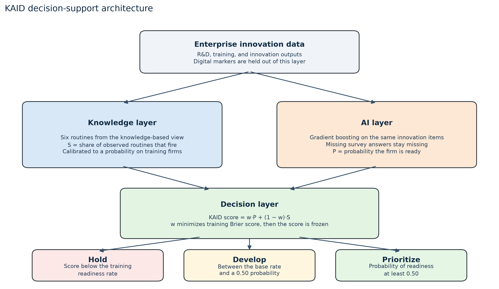

# A knowledge-based AI decision-support model for predicting digital transformation readiness from enterprise innovation data

**Sai Vignesh Akkineni**

Short communication prepared for *Digital Business* (Elsevier). The live author guide should be checked for the current word limit before submission.

## Abstract

Firms buy software and still have nothing new to sell. This short communication offers KAID, a decision aid that reads enterprise innovation data and returns one of three actions: hold, develop, or prioritize a digital offer. The knowledge layer codes six routines from the knowledge-based view. The AI layer is a gradient-boosting model on the same innovation items. Digital markers — website, an informatics department, and software, hardware, and ICT expenditure — form the readiness label and are kept out of the predictors. On the public Latin American innovation surveys, 14,663 firm-years and 12,070 enterprises, the knowledge layer reaches a holdout AUC of 0.854. Boosting reaches 0.891. A blend that puts 95 percent of the weight on boosting does not improve on boosting alone. The decision bands do separate firms: 4.0 percent of Hold firms are ready, 38.4 percent of Develop firms, and 64.5 percent of Prioritize firms. Hold firms are missing process innovation. Develop firms are missing innovation training. Prioritize firms still often lack an R&D routine.

**Keywords:** artificial intelligence; data; knowledge-based view; digital transformation; innovation; entrepreneurship; decision support

## 1. The decision problem

A data-centric business model depends on an offer that customers will pay for, not on a model that sits inside one team (Hartmann, Zaki, Feldmann, & Neely, 2016). Digital entrepreneurship is the act of pursuing that offer (Nambisan, 2017). Digital transformation is the change in how the firm creates value (Vial, 2019). None of those statements tells a manager whether this firm, with this innovation record, should spend the next budget on software.

The knowledge-based view says the firm exists to integrate specialist knowledge into a productive routine (Grant, 1996; Kogut & Zander, 1992). An AI output is another specialist product. It changes the business model only when the surrounding routines can use it. KAID makes that claim operational. It predicts digital-transformation readiness from enterprise innovation data, and it names the routine that is missing.

## 2. KAID

Figure 1 is the model. The same innovation record is read twice.

The knowledge layer scores six routines. A routine fires when the firm reports the underlying activity. The score is the share of routines that fire. Isotonic regression, fit on training firms only, maps that share to a probability.

The AI layer is histogram gradient boosting (Friedman, 2001) on the same items, plus country, year, sector, foreign ownership, group membership, and log employment. Missing answers stay missing. The trees may split on a missing value only for items that were asked of almost every firm in the estimation sample. Two items failed that test and were removed from the main model: innovation cooperation, which was not asked of 39 percent of firms, and the internet as an information source, which was not asked of 51 percent. Of the firms who were not asked about cooperation, 0.1 percent were coded ready. Of the firms who were not asked about the internet, 2.8 percent were coded ready. A model that used those gaps would have been scoring the questionnaire.

The decision layer forms

KAID score = w · P + (1 − w) · S,

where P is the boosting probability and S is the calibrated knowledge probability. The weight w is chosen on out-of-fold predictions inside the training sample to minimize the Brier score, then frozen. Firms are not classified by that weight. They are placed in a band with two cuts fixed before looking at the holdout: Hold if the score is below the training readiness rate, Develop if it is at least that rate and below 0.50, and Prioritize if it is at least 0.50. The band says whether to pursue the digital offer. The routine that most separates the band from Prioritize firms says what to build first.

## 3. Enterprise innovation data

The source is the public Harmonized Latin American Innovation Surveys database, LAIS (Crespi, Guillard, Salazar, & Vargas, 2022). The estimation sample keeps a firm-year only when at least three of the five digital markers were asked. Readiness equals one when at least half of the markers that were asked equal one. That rule yields 14,663 firm-years, 12,070 enterprises, in Ecuador, El Salvador, Panama, Paraguay, and Peru, from 2009 to 2016. The ready share is 23.6 percent.

Table 1 separates the label from the predictors. Software, hardware, and ICT expenditure were asked of every firm in the sample. The informatics department was asked of 90.6 percent. A website was asked of 25.8 percent, so the label is mostly a digital-spend and digital-organization bundle, with the website used where the survey asked it. The markers are not five independent technologies: in these questionnaires, software and hardware expenditure sit close to the ICT item. The label is that bundle.

The holdout is a group split by enterprise, 20 percent of enterprises, seed 42. No enterprise is in both samples. The training sample has 11,731 firm-years (9,656 enterprises) and the holdout has 2,932 firm-years (2,414 enterprises). The holdout ready rate is 23.3 percent.

**Table 1. Label and knowledge routines**

*Panel A. Digital markers, used only as the label*

| Marker | Positive among firms asked | Share asked |
|---|---:|---:|
| Website | 50.5% | 25.8% |
| Informatics and systems department | 33.0% | 90.6% |
| Software innovation expenditure | 18.5% | 100% |
| Hardware innovation expenditure | 16.7% | 100% |
| ICT innovation expenditure | 24.1% | 100% |

*Panel B. Knowledge routines, used only as predictors*

| Routine | Survey definition | Firms in which it fires |
|---|---|---:|
| Knowledge creation | In-house R&D expenditure or a formal R&D department | 19.9% |
| External knowledge | External R&D expenditure | 6.0% |
| Training | Innovation-related training expenditure | 21.3% |
| Organizational integration | Organizational innovation | 27.9% |
| Product innovation | At least one product innovation | 32.0% |
| Process innovation | At least one process innovation | 34.9% |

*Note.* Estimation sample: 14,663 firm-years, 12,070 enterprises, ready share 23.6%. Innovation items follow the Oslo Manual (OECD/Eurostat, 2018).

## 4. Holdout results

Figure 2 and Table 2 report the holdout. The knowledge layer alone reaches an AUC of 0.854. Boosting reaches 0.891. The training step sets w at 0.95. The blended score reaches an AUC of 0.891 and a Brier score of 0.110, against 0.891 and 0.110 for boosting alone. Unrounded, the blend is slightly worse (AUC 0.8912 against 0.8914; Brier 0.11003 against 0.11000). KAID does not predict better than the AI layer. It matches it, and it adds the routine.

The probabilities are on the scale of the outcome. Mean predicted probability on the holdout is 0.237 for the AI layer and 0.237 for KAID, against a ready rate of 23.3 percent. The 0.50 Prioritize cut is therefore a high bar: the model is saying the firm is more likely ready than not, in a sample where only about one firm in four is ready.

The bands are the result a manager can use. Of 2,932 holdout firm-years, 1,786 fall in Hold and 4.0 percent of them are ready. 487 fall in Develop and 38.4 percent are ready. 659 fall in Prioritize and 64.5 percent are ready. Relative to Prioritize firms, Hold firms are distinguished by the absence of process innovation (93.5 percent absent, against 11.8 percent in Prioritize). Develop firms are distinguished by the absence of innovation training (72.9 percent absent, against 29.3 percent). Inside Prioritize, the routine most often still missing is knowledge creation: 48.0 percent have neither in-house R&D expenditure nor an R&D department.

Process innovation is the strongest single predictor. Dropping it and refitting the boosting layer leaves a holdout AUC of 0.852. The result is not one questionnaire item. Training and product innovation are the next largest contributions.

Cooperation was kept out of the main model for the reason given above. On the 1,782 holdout firms who were actually asked, cooperation alone has an AUC of 0.634, and adding it to the boosting layer moves AUC from 0.800 to 0.811. Where the question was fielded, cooperation is a real but small increment. It is not safe to use where the question was omitted.

**Table 2. Holdout performance and decision bands**

*Panel A. Discrimination and classification. F1, precision, and recall use the threshold chosen on training out-of-fold scores. AUC and Brier do not use that threshold.*

| Layer | AUC | F1 | Precision | Recall | Balanced accuracy | Brier |
|---|---:|---:|---:|---:|---:|---:|
| Knowledge | 0.854 | 0.626 | 0.502 | 0.833 | 0.791 | 0.125 |
| AI | 0.891 | 0.678 | 0.565 | 0.848 | 0.825 | 0.110 |
| KAID | 0.891 | 0.678 | 0.584 | 0.808 | 0.817 | 0.110 |

*Panel B. Bands on the 2,932 holdout firm-years. The routine is the one whose absence most exceeds its absence among Prioritize firms. For Prioritize, it is the common routine most often still absent.*

| Band | Firm-years | Actually ready | Routine the band points to |
|---|---:|---:|---|
| Hold | 1,786 | 4.0% | Process innovation |
| Develop | 487 | 38.4% | Training for innovation |
| Prioritize | 659 | 64.5% | Knowledge creation |

## 5. What to do with the score

An entrepreneur deciding whether to build a data-centric offer can read the band as a go-condition. A Hold firm is not a candidate for that offer: about one in twenty-five is digitally ready, and the innovation record is missing a process routine. The next spend is the routine, not another license. A Develop firm is a maybe. The distinctive gap is training. Buying software before people can use the new process repeats the failure the introduction described. A Prioritize firm is the candidate. Even there, about half the firms have no R&D routine, so the digital offer still needs a place where knowledge is created and kept, which is the mechanism in Grant (1996).

The same reading applies inside an established firm. Teece (2010) treats the business model as the architecture through which a capability is delivered. KAID does not design that architecture. It says whether the innovation record can support a digital one. Foss and Saebi (2017) ask business-model research to specify the change, not only the technology. The change KAID supports is a narrow one: pursue the offer, build training, or stay with the current model.

## 6. What this evidence does not show

The label is a survey proxy. It is not revenue from a data product, and it is not a completed transformation. The five countries and the years 2009–2016 are the waves in which enough digital markers were asked. A website was on the questionnaire for only a quarter of the estimation sample. Process innovation, under the Oslo Manual, can include support activities, so part of its contribution sits near the label even though the spend items themselves are not predictors. The design is cross-sectional. Training can follow a digital project as well as precede it. The blend does not beat boosting, and a reader who wants only a probability can stop at the AI layer. What that layer will not do is name the routine.

The microdata are not included here. LAIS is distributed by the Inter-American Development Bank under CC BY-NC-ND 3.0 IGO. The script downloads the public file, rebuilds both figures, and writes the metrics in `results.json`.

## References

Crespi, G., Guillard, C., Salazar, M., & Vargas, F. (2022). *Harmonized Latin American Innovation Surveys Database (LAIS): Firm-level microdata for the study of innovation, 2007–2017*. Inter-American Development Bank. https://doi.org/10.60966/hbz4-cm10

Foss, N. J., & Saebi, T. (2017). Fifteen years of research on business model innovation: How far have we come, and where should we go? *Journal of Management, 43*(1), 200–227. https://doi.org/10.1177/0149206316675927

Friedman, J. H. (2001). Greedy function approximation: A gradient boosting machine. *Annals of Statistics, 29*(5), 1189–1232. https://doi.org/10.1214/aos/1013203451

Grant, R. M. (1996). Toward a knowledge-based theory of the firm. *Strategic Management Journal, 17*(S2), 109–122. https://doi.org/10.1002/smj.4250171110

Hartmann, P. M., Zaki, M., Feldmann, N., & Neely, A. (2016). Capturing value from big data – a taxonomy of data-driven business models used by start-up firms. *International Journal of Operations & Production Management, 36*(10), 1382–1406. https://doi.org/10.1108/IJOPM-02-2014-0098

Kogut, B., & Zander, U. (1992). Knowledge of the firm, combinative capabilities, and the replication of technology. *Organization Science, 3*(3), 383–397. https://doi.org/10.1287/orsc.3.3.383

Nambisan, S. (2017). Digital entrepreneurship: Toward a digital technology perspective of entrepreneurship. *Entrepreneurship Theory and Practice, 41*(6), 1029–1055. https://doi.org/10.1111/etap.12254

OECD/Eurostat. (2018). *Oslo Manual 2018: Guidelines for collecting, reporting and using data on innovation* (4th ed.). OECD Publishing. https://doi.org/10.1787/9789264304604-en

Teece, D. J. (2010). Business models, business strategy and innovation. *Long Range Planning, 43*(2–3), 172–194. https://doi.org/10.1016/j.lrp.2009.07.003

Vial, G. (2019). Understanding digital transformation: A review and a research agenda. *The Journal of Strategic Information Systems, 28*(2), 118–144. https://doi.org/10.1016/j.jsis.2019.01.003
